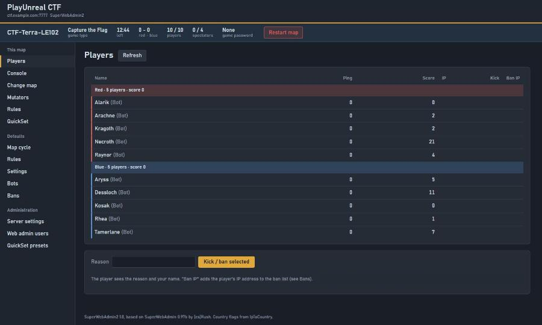
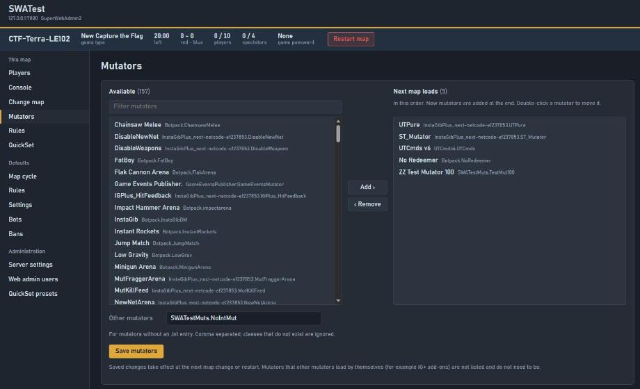
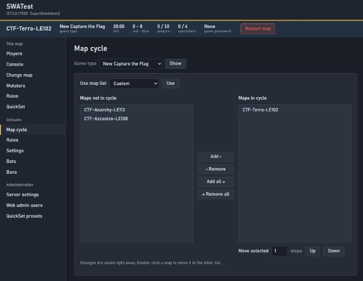
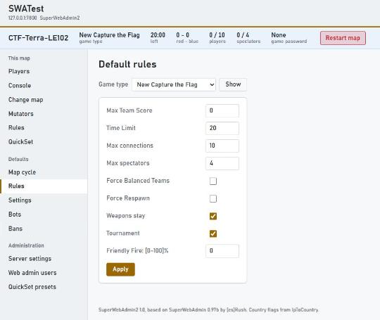

# SuperWebAdmin2

A web admin for Unreal Tournament 99 servers running OldUnreal 469. You manage the
server from a browser: players, map changes, mutators, rules, the map cycle, bans,
users and server settings.

SuperWebAdmin2 is a maintained continuation of **SuperWebAdmin 0.97b** by [es]Rush
(2005), rebuilt for the PlayUnreal CTF servers. It fixes the bugs that hurt us in
practice, closes several security holes and replaces the old frame-based pages with a
modern, responsive interface. Scripts that talk to the old web admin (such as a pug bot
that sets the password and map) keep working unchanged.



| | | |
|---|---|---|
|  |  |  |

## Compared to SuperWebAdmin 0.97b

### Map changes keep the server as it was started

This was the main reason for SuperWebAdmin2.

- **0.97b** rebuilt the next map's mutator list from the mutators that happened to be
  running. That had several side effects:
  - Mutators that other mutators load themselves (IG+ add-ons, SmartCTF) were added
    to the URL.
  - Mutators without an `.int` entry, or listed after the 50th, were silently dropped.
  - Every other URL option (`?IGPlusSettings=`, `?Tickrate=`, ...) was lost on the
    next map change.
- **SuperWebAdmin2** keeps the exact `?mutator=` list and all other options. There is no
  limit on the number of mutators.

### A new interface

| 0.97b | SuperWebAdmin2 |
|---|---|
| Frames, one menu frame and one content frame | One page per view, works on phones |
| Server name hidden | Server name and address in the top bar, and on the login page |
| No overview | An info bar on every page: map, game type, time left, score, players, spectators, game password |
| Restart is a plain link | Restart sits in the info bar and asks first |
| One flat player list | Players grouped per team with the team score, spectators last |
| Two small select boxes for mutators | Two lists with a filter, class names shown, double-click to move, order kept |
| Light grey pages | Dark theme by default, light theme one click away (remembered per browser) |
| Browser's Basic Auth popup, no real log out | A login page, a 7-day session that survives map changes, and a Log out button |
| User management spread over three pages | One users page, with an explanation of what each level may do |

### Security

- Cross-site requests are refused, so another web page cannot make an admin's browser
  run commands.
- Usernames containing `:` are refused. In 0.97b they could create a Super admin account
  without a password.
- Accounts without a password are locked. In 0.97b they were open.
- Passwords of 22 characters or more work. In 0.97b they never did.
- After 5 failed logins from one IP within 60 seconds, that IP is locked out for 60
  seconds.
- Map names, game types, IP masks and passwords are validated, and all HTML output is
  escaped.
- Game and admin passwords are no longer written to the log.
- Browser sessions are stored only as a hash. Changing a password or deleting a user ends
  that user's sessions.

### Fixes

- NewCTF shows up in the game type lists.
- The tick rate can be set above 99, and MaxClientRate above 30000.
- QuickSet validates everything before it applies anything.
- Dynamic bans keep their reason.
- Console replies no longer swallow chat lines.
- About 30 smaller crash and logic bugs.

### Removed

- Support for UTDC, UTGL, EasyMute, MvReporter and ngWorldStats. None of them are in use
  any more.
- Mass editing of ban lists now needs level 3.

## Install

Download `SuperWebAdmin2-1.0.zip` from the Releases page. It contains `System/` and
`Web/`, laid out like the server.

1. Copy `System/` and `Web/` into the server's UT folder, merging with the folders that
   are there. On a server with SuperWebAdmin 0.97b this overwrites most of its
   templates in `Web/`; that is intended. `Web/flags/` and `Web/favicon.ico` are the
   same files as in 0.97b.
2. In the server ini, section `[Engine.GameEngine]`, add:
   ```ini
   ServerActors=SuperWebAdmin2.SWAServer
   ```
3. Create `System/SWAConfig.ini` from `System/SWAConfig.ini.EXAMPLE` and set:
   - `ListenPort`: the web admin's port
   - `AdminRealm`: a name for the server
   - `UserList[0]=name:password:5`: the first user, a Super admin. The password is
     replaced by a hash the first time the server starts.
   - `Salt`: 10 or more random characters
4. Restart the server. The log shows `SuperWebAdmin2` with the port. Open
   `http://server:port/` and log in.

UT's own web admin (`UWeb.WebServer`) uses the same template file names, so its pages
no longer work once SuperWebAdmin2 is installed (the same was true with 0.97b). Switch it
off with `bEnabled=False` in the `[UWeb.WebServer]` section.

## Upgrading from SuperWebAdmin 0.97b

1. Copy the files as in step 1 above.
2. In the server ini, replace `ServerActors=SuperWebAdmin.SWAServer` with
   `ServerActors=SuperWebAdmin2.SWAServer`. Only one of the two may run.
3. In `SWAConfig.ini`, rename the section `[SuperWebAdmin.SWAConfig]` to
   `[SuperWebAdmin2.SWAConfig]`. Users, password hashes and the salt carry over, so
   everybody keeps their password.
4. Optional: remove the lines `UTDCLogDir`, `bForceUTGLModeOff` and `ForceUTGLModeOff`.
   They are ignored.
5. Restart the server.

Old bookmarks keep working: `/`, `current?Page=...` and so on redirect to the new
pages.

To go back to 0.97b, install it again from its own release zip.

### Removing the old 0.97b files

SuperWebAdmin2 overwrites most of the 0.97b templates. These are left over and can be
deleted:

- `System/SuperWebAdmin.u`
- In `Web/`:
  - `blankpage.uhtm`, `menu.uhtm`, `root.uhtm`, `style.css`, `welcomepage.uhtm`
  - `current.uhtm`, `current_console_send.uhtm`, `current_menu.uhtm`,
    `current_mvrcontrol.uhtm`
  - `defaults.uhtm`, `defaults_menu.uhtm`
  - `ob_message.uhtm`
  - `superadmin.uhtm`, `superadmin_adminwebadmin2.uhtm`, `superadmin_adminwebadmin3.uhtm`,
    `superadmin_menu.uhtm`, `superadmin_mvrconfig.uhtm`
  - `utdcshot.uhtm`, `utdcshotready.uhtm`
  - every `mvr_*.uhtm`

Delete only the files named above. Other web admins keep their own files in `Web/` too
(for example `defaults_md5ignore.uhtm`, `defaults_server.uhtm`, `jail_*`, `images/`,
`inc/`).

### Compatibility for scripts

Scripts keep using HTTP Basic Auth with every request, exactly as before. These requests
behave as in 0.97b:

- `POST /current_rules` with `MaxPlayers`, `MaxSpectators`, `GamePassword`, `Apply`
- `POST /current_game` with `MapSelect`, `SwitchMap`
- `GET /current_players`, which still contains `KickPlayer` / `No Players Connected`

The only difference: an invalid game password now returns HTTP 400 instead of 200.

### VoteSys

VoteSys treats every map change it did not make itself as a server restart, and
switches straight to its default preset and map. On a server with VoteSys, change maps
through VoteSys; a map change from the web admin is undone right away. 0.97b had the
same problem.

## Privilege levels

| Level | Name | May |
|---|---|---|
| 1 | Public moderator | players (kick and ban), change map, console chat, bans, ban lists |
| 2 | Public admin | level 1 plus mutators, rules, restart, game type |
| 3 | Server moderator | the level 1-2 pages also during tournaments (except game type), QuickSet, mass editing of ban lists |
| 4 | Server admin | level 3 plus the Defaults pages (map cycle, rules, settings, bots), game type, console `/mutate` |
| 5 | Super admin | level 4 plus server settings, web admin users, QuickSet presets, any console command |

Levels 1 and 2 cannot log in while the server is in tournament mode. This is how 0.97b
behaves as well.

## Logging in

Browsers get a login page that shows the server's name, so you can see that you reached
the right server. After logging in, a session cookie lasts 7 days and survives map
changes. **Log out** in the top bar ends it. Only a hash of each session token is
stored, in `SWAConfig.ini` (`Sessions[...]`).

A request without login that does not ask for an HTML page gets the Basic Auth
challenge (401), as before.

## Security notes

The web admin uses plain HTTP, as UT's own web admin does, so passwords and the session
cookie cross the network unencrypted. Open the port in the firewall only for the
addresses that need it, for example a bot's server and your own IP. Alternatively, put
it behind stunnel or a reverse proxy with TLS.

## Credits

SuperWebAdmin by [es]Rush. OPBan by PurplePants. Country flags from IpToCountry.
SuperWebAdmin2 is maintained for PlayUnreal.
